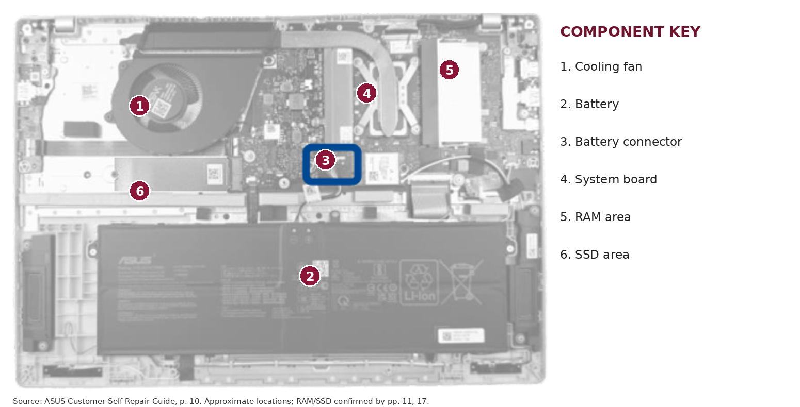

# Lab 03 — Teardown without a screwdriver

## 1. The machine

- **Manufacturer:** ASUSTeK COMPUTER INC.
- **Exact model:** ASUS Vivobook S 16 S3607VA_S3607VA (PowerShell `Win32_ComputerSystem`)
- **Motherboard product:** S3607VA (`Win32_BaseBoard`)
- **CPU:** Intel Core 5 210H; 8 physical cores, 12 logical processors
- **Memory reported by Windows:** two 8 GiB entries, DDR5, 5600 MT/s, SMBIOS form factor 12 (SO-DIMM)
- **Storage:** BIWIN CE980Q41R00-512, NVMe SSD, approximately 512 GB nominal
- **Manufacturer guide:** ASUS Customer Self Repair (CSR) Maintenance and Service Guide, first edition March 2025 (supplied PDF; see pages 9–12 and 15–18). This guide is a repair guide, not a full exploded-parts list or specification sheet.

## 2. Components and annotated figure

The annotated image is based on the internal view on **guide p. 10**. The RAM and SSD locations are cross-checked against **pp. 11 and 17**. Locations are approximate, and the guide warns that appearance can vary by model.

| # | What | Connects to | Limits / constraints | Source |
|---|---|---|---|---|
| 1 | Cooling fan | Cooling assembly and system board | Cooling capability limits sustained CPU performance; exact thermal rating not specified | Guide p. 10 (visible); exact rating not given |
| 2 | Internal battery | System board via battery cable | Must be disconnected before component service; battery capacity not specified in guide | Guide pp. 5, 10 |
| 3 | Battery connector | Battery cable to system board | Requires correct cable orientation; not an upgrade socket | Guide pp. 10, 13 |
| 4 | System board | CPU, memory, storage, battery, cooling | Board determines component compatibility; full board specifications not supplied | Guide p. 10; Windows `Win32_BaseBoard` |
| 5 | DDR5 SO-DIMM RAM module / compartment | Memory slot on system board | Replacement documented, but guide does not establish maximum supported GB or number of replaceable slots in this exact configuration | Guide pp. 9–12; Windows `Win32_PhysicalMemory` |
| 6 | M.2 SSD module | M.2 slot on system board | Replacement documented; guide does not specify M.2 length, maximum SSD capacity or extra free slots | Guide pp. 15–18; Windows `Get-PhysicalDisk` |

**Caution:** The CPU package and other unlabeled small components cannot be confidently distinguished from this low-resolution CSR image; the supplied guide does not provide a full exploded view. No physical disassembly was performed.

## 3. Upgrade verdict

| Component | Manual says | OS says | Verdict |
|---|---|---|---|
| RAM | A RAM module can be removed and installed (pp. 9–12). No maximum capacity is stated. | Two 8 GiB DDR5-5600 SO-DIMM entries; `MemoryDevices=2`, firmware `MaxCapacity=67108864 KB` (64 GiB). | **Partly:** replacement of a module is documented. Do **not** assume two physical replaceable slots or 64 GiB support without model-specific specifications. |
| Storage | A compatible M.2 SSD can be removed/replaced (pp. 15–18). | BIWIN 512 GB NVMe SSD. | **Yes, replacement:** compatible M.2 SSD. Exact size/form factor and supported capacity must be verified before purchase. |
| CPU | No CPU replacement procedure or compatible CPU list. | Intel Core 5 210H, `SocketDesignation=U3E1`; this value alone does not prove a replaceable socket. | **No supported upgrade established:** treat as non-user-upgradeable unless ASUS documents otherwise. |

**Manual vs OS disagreement:** Windows firmware reports a maximum of 64 GiB and two memory devices, while the repair guide shows a replaceable RAM module but does not confirm the 64 GiB limit or two removable sockets. SMBIOS values describe firmware records, not necessarily the physical number of upgradeable slots. For physical service and replacement procedures, the ASUS guide is stronger evidence; for installed modules and current resource usage, the OS output is stronger. Neither source alone proves the supported RAM upgrade ceiling.

## 4. Windows / Linux comparison

Ubuntu was run **inside VMware**, not directly on the ASUS hardware. Values for the Linux guest are virtual allocations.

| Fact | Windows host (command → field → value) | Linux guest (command → field → value) |
|---|---|---|
| CPU model | `Win32_Processor` → `Name` → Intel Core 5 210H | `lscpu` → `Model name` → Intel Core 5 210H (exposed by VMware) |
| CPU count | `Win32_Processor` → `NumberOfCores` → 8 | `lscpu` → `CPU(s)` → 2 vCPUs |
| Logical processors | `Win32_Processor` → `NumberOfLogicalProcessors` → 12 | `lscpu` → `On-line CPU(s) list` → 0,1 |
| RAM | `Win32_ComputerSystem` → `TotalPhysicalMemory` → 16,802,062,336 bytes | `free -h` → `Mem: total` → approx. 5.2 GiB |
| RAM technology | `Win32_PhysicalMemory` → `SMBIOSMemoryType` → 34 (DDR5) | `dmidecode -t memory` → guest-emulated SMBIOS; not a physical DDR5 measurement |
| Memory speed | `Win32_PhysicalMemory` → `Speed` → 5600 MT/s | `dmidecode -t memory` → virtual firmware-reported memory attributes |
| Disk size | `Get-PhysicalDisk` → `Size` → 512,110,190,592 bytes | `lsblk` → virtual disk size → 20G (from collected output) |
| Disk interface | `Get-PhysicalDisk` → `BusType` → NVMe | `lsblk` → `TRAN` → virtual device-dependent, not host NVMe proof |
| Motherboard | `Win32_BaseBoard` → `Product` → S3607VA | `dmidecode -t baseboard` → VMware virtual board |

**Interpretation:** VMware exposes the host CPU name but allocates fewer virtual CPUs and less memory to the guest. Ubuntu's virtual disk is not the host's 512 GB NVMe SSD. Host PowerShell output is the correct source for physical ASUS upgrade decisions, while guest Linux output describes the VM.

## 5. Evidence and privacy

- `evidence/windows-specs.txt` — host PowerShell transcript (personal host/user names redacted).
- `evidence/linux-specs.txt` — Ubuntu VM command output.
- `evidence/manual-figures/annotated-internals.png` — numbered internal-view figure, adapted from the supplied ASUS guide.

The original ASUS PDF is **not redistributed** in this repository; cite the manufacturer's guide and page numbers above. The provided guide does not contain a complete exploded view, so the annotated figure identifies the clearly visible major parts only.
